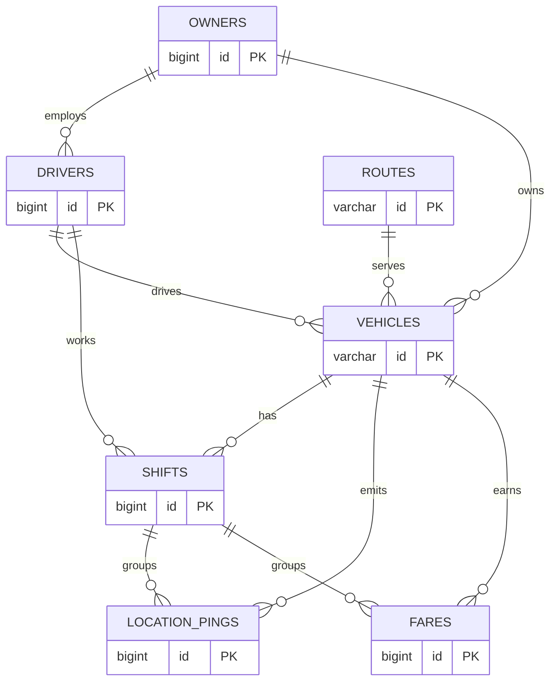

# trans_sport data model (backend v1)

The canonical schema is [`backend/sql/schema.sql`](../backend/sql/schema.sql) (PostgreSQL 12+, no
extensions). SQLAlchemy models in `backend/models.py` mirror it; SQLite is used only for local
development and tests so the API runs with one command and no database server.

## Entities



| Table | Purpose | Important columns / rules |
|---|---|---|
| `owners` | Fleet owners, also the OTP sign-in principal for the dashboard | `phone` unique; `name` |
| `drivers` | Drivers, each belongs to one owner | `owner_id` FK, `phone` unique (nullable until sign-in) |
| `routes` | Pilot routes (A–D in `web/sim.js`) | `fare_minor`, `city_timezone` (IANA name, default `Africa/Lagos`) |
| `vehicles` | Minibuses | `id` is the public string from the web app (`v1`…`v8`); `owner_id`, `driver_id`, `route_id`, `plate` unique, `seats`, `active` |
| `shifts` | A driver's on-shift period | `started_at`, nullable `ended_at`; at most one open shift per vehicle and per driver (partial unique indexes) |
| `location_pings` | GPS points received from the driver app | `vehicle_id`, `shift_id?`, `lat` ∈ [-90, 90], `lng` ∈ [-180, 180], `accuracy >= 0`, `ts` (device time, UTC-normalised) |
| `fares` | Cash and mobile-money fares | `amount_minor > 0`, `method ∈ ('cash','mobile_money')`, `ts`, `shift_id?` |
| `otp_codes` | Pilot sign-in codes | hashed code, `expires_at`, `attempts`, `consumed_at` — the code itself is never stored |
| `auth_tokens` | Bearer sessions | SHA-256 of the token, `role`, `principal_id`, `expires_at` |

## Money and time

- Money is stored in **minor units** as `BIGINT` (`fares.amount_minor`, `routes.fare_minor`).
  For NGN, 1 NGN = 100 kobo, so ₦500 is `50000`.
- The HTTP payload accepts `amount` in **major units** (NGN) because that is what `web/app.js`
  posts today (`amount: v.route.fare`). The API round-trips it to integer kobo and rejects more
  than two decimal places. Every fare response contains both `amount` and `amountMinor`.
- All timestamps are stored as UTC (`TIMESTAMPTZ` in PostgreSQL). `ts` accepts epoch **milliseconds**
  (`Date.now()` in the browser) or an ISO-8601 string with an offset.
- Daily earnings are grouped in the **city timezone** taken from the vehicle's route
  (`routes.city_timezone`, default `Africa/Lagos`). `GET /vehicles/{id}/earnings?days=7` returns the
  last N local calendar days, zero-filled, plus totals split by `cash` / `mobile_money`. A fare at
  23:30 local and one at 00:30 local fall into different days even though both are "today" in UTC.

## Mapping to `web/config.js`

| Front-end call | Payload | Stored as |
|---|---|---|
| `POST /locations` | `{ vehicleId, lat, lng, accuracy, ts }` | one `location_pings` row; `shift_id` filled from the vehicle's open shift |
| `POST /fares` | `{ vehicleId, amount, method, ts }` | one `fares` row with `amount_minor = round(amount * 100)` |

## Ownership and access rules

- `role=owner` tokens can read/write only vehicles where `vehicles.owner_id = principal_id`.
- `role=driver` tokens can read/write only vehicles where `vehicles.driver_id = principal_id`.
- A request for any other vehicle returns `400` with the same message as an unknown vehicle, so the
  API does not reveal whether another owner's vehicle exists.
- `POST /locations`, `POST /fares`, `GET /vehicles`, `GET /vehicles/latest`,
  `GET /vehicles/{id}/earnings` and the shift endpoints all require a bearer token.

## Useful queries (PostgreSQL)

Newest ping per vehicle:

```sql
SELECT DISTINCT ON (vehicle_id) vehicle_id, lat, lng, accuracy, ts
FROM location_pings
ORDER BY vehicle_id, ts DESC, id DESC;
```

Daily cash vs mobile-money totals in Lagos local time:

```sql
SELECT (ts AT TIME ZONE 'Africa/Lagos')::date AS day,
       SUM(amount_minor) FILTER (WHERE method = 'cash') AS cash_minor,
       SUM(amount_minor) FILTER (WHERE method = 'mobile_money') AS mobile_minor
FROM fares
WHERE vehicle_id = 'v1'
GROUP BY 1
ORDER BY 1 DESC;
```
