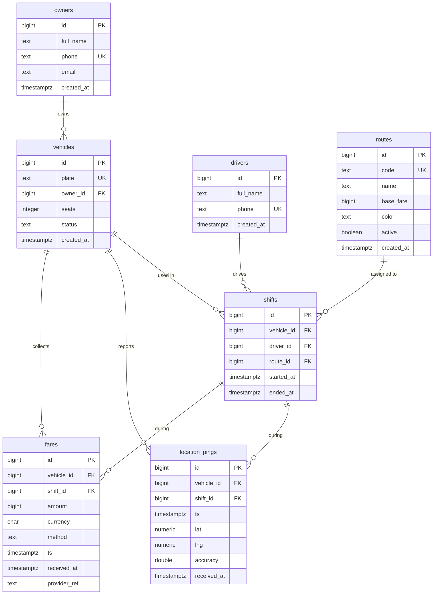

# Data model

This document describes the PostgreSQL schema in [`backend/schema.sql`](../backend/schema.sql). It is the storage contract for the driver app and the owner dashboard: pings posted to `POST /locations` land in `location_pings`, fares posted to `POST /fares` land in `fares`, and the owner's views join those rows back to `vehicles`, `drivers` and `routes`.

## Conventions

- **Identifiers** are `BIGINT GENERATED ALWAYS AS IDENTITY`. The web app treats ids as opaque strings (`vehicleId`), so the API parses them before inserting and serialises them back when reading.
- **Money** is stored as `BIGINT` minor units (kobo for NGN), never as floating point: `500` means ₦5.00. `routes.base_fare` and `fares.amount` use the same unit.
- **Timestamps** are `TIMESTAMPTZ`. `ts` is the client's event time from the JSON payload; `received_at` is the server's ingest time and defaults to `now()`.
- **Business day** for earnings is `Africa/Lagos` (UTC+01:00, no DST). The API converts a Lagos calendar day to a half-open UTC instant range; the indexes are designed for that range scan.
- No extensions are required, so the file loads into a plain PostgreSQL 12+ database.

## Relationships



## Tables

### owners

An owner is the person or company that pays for the service and reads the dashboard. `owners` stores the contact details needed for onboarding and account recovery: a non-empty `full_name`, a unique `phone` (the primary login identifier in this market), an optional `email`, and `created_at`. Each owner can have many vehicles; deleting an owner is rejected while they still own any vehicle (`ON DELETE RESTRICT`) so financial history is never orphaned.

### drivers

A driver is the person who signs in on the phone app, starts a shift and collects fares. The table mirrors `owners` with a unique `phone` and a non-empty `full_name`, plus `created_at`; it deliberately has no owner column because a driver may work different vehicles for different owners over time, and that relationship is recorded per shift instead. Driver performance in the owner dashboard (trips and takings) is derived by joining `drivers` → `shifts` → `fares`.

### vehicles

A vehicle is a minibus in an owner's fleet, identified by its number `plate` (unique) and linked to exactly one `owner_id`. `seats` is the passenger capacity and `status` is constrained to `active`, `idle` or `offline`, matching the three states used by the simulation (`web/sim.js`); `created_at` records onboarding. A vehicle accumulates many `location_pings` and many `fares`, and appears in many `shifts`. Pings may be deleted with the vehicle, but fares and shifts are kept, so references from those tables use `ON DELETE RESTRICT`.

### routes

A route is a named corridor such as "Ikeja → Oshodi → Mile 2". `code` is the short stable label shown on the bus marker (`A`, `B`, `C`, `D` in the demo) and `name` is the human-readable version; `color` is the marker colour used by the UI. `base_fare` is the standard fare in minor units (kobo) and `active` allows a route to be retired without destroying old shifts. Stops and geometry are not stored here yet — the schema only needs the route identity and fare for this task, and the API can extend it later without a breaking change.

### shifts

A shift is the period during which one driver operates one vehicle, optionally on one route; it is the operational context that makes a burst of pings and fares attributable to a person. `started_at` and `ended_at` are instants, with a check that an ended shift cannot finish before it started, and a NULL `ended_at` means "currently on shift". Two partial unique indexes allow at most one open shift per vehicle and per driver, which prevents duplicate GPS sessions when a phone reconnects. Pings and fares reference `shift_id` when the API knows the active shift, but the column is nullable so a receipt that arrives just after a shift ends is still stored.

### location_pings

A location ping is one GPS sample sent by the driver app. Its columns map directly to `web/config.js`: `vehicleId` → `vehicle_id`, `lat` → `lat`, `lng` → `lng`, `accuracy` → `accuracy` (metres, non-negative) and `ts` → `ts`; `received_at` is added by the database. Latitude and longitude are `NUMERIC(9,6)` with range checks, which is precise enough for street-level tracking and avoids floating-point surprises. Pings are append-only telemetry: the `location_pings_latest_per_vehicle_idx` index on `(vehicle_id, ts DESC, id DESC)` supports the "where is every bus now?" query and `DISTINCT ON (vehicle_id)` lookups without a sort over the whole table.

### fares

A fare is one payment recorded by the driver, either cash tapped in the app or a mobile-money request that has been settled. It stores `amount` as a positive integer in minor units (kobo; `COMMENT ON COLUMN` documents this), a three-letter `currency` defaulting to `NGN`, and `method` constrained to exactly `cash` or `mobile_money` — the two values in `web/config.js`. `vehicle_id`, `shift_id`, `ts` (client event time) and `received_at` mirror the ping payload, while `provider_ref` is an optional reference for reconciling mobile-money transactions. Fares are financial records, so deleting a referenced vehicle or shift is blocked; the `fares_vehicle_day_idx` covering index on `(vehicle_id, ts) INCLUDE (amount, method, currency)` serves "takings per vehicle per day" without touching the table.

## API payload mapping

These are the exact payloads documented in `web/config.js`; the API is responsible only for translating `vehicleId` to the integer primary key and for validating ranges already enforced by the table checks.

| `POST /locations` field | Column | Type / rule |
|---|---|---|
| `vehicleId` | `location_pings.vehicle_id` | string id of an existing `vehicles.id` |
| `lat` | `location_pings.lat` | decimal degrees, −90…90 |
| `lng` | `location_pings.lng` | decimal degrees, −180…180 |
| `accuracy` | `location_pings.accuracy` | metres, ≥ 0 |
| `ts` | `location_pings.ts` | ISO-8601 instant stored as `TIMESTAMPTZ` |

| `POST /fares` field | Column | Type / rule |
|---|---|---|
| `vehicleId` | `fares.vehicle_id` | string id of an existing `vehicles.id` |
| `amount` | `fares.amount` | positive integer, minor units (kobo) |
| `method` | `fares.method` | `cash` or `mobile_money` |
| `ts` | `fares.ts` | ISO-8601 instant stored as `TIMESTAMPTZ` |

## Index usage

```sql
-- Latest ping for each vehicle (uses location_pings_latest_per_vehicle_idx):
SELECT DISTINCT ON (vehicle_id) vehicle_id, lat, lng, ts
FROM location_pings
ORDER BY vehicle_id, ts DESC, id DESC;

-- Takings per vehicle for one Lagos day, 2026-01-15 (uses fares_vehicle_day_idx).
-- The bounds are UTC instants for 00:00 and 24:00 Lagos time (UTC+01:00).
SELECT vehicle_id,
       sum(amount) FILTER (WHERE method = 'cash') AS cash_minor,
       sum(amount) FILTER (WHERE method = 'mobile_money') AS mobile_minor
FROM fares
WHERE vehicle_id = $1
  AND ts >= TIMESTAMPTZ '2026-01-14 23:00:00+00'
  AND ts <  TIMESTAMPTZ '2026-01-15 23:00:00+00'
GROUP BY vehicle_id;
```

Trip-level reporting is derived from these tables rather than stored twice: a completed trip is the span between a shift's `started_at` and `ended_at`, with its passengers and earnings counted from the `fares` rows in that span. That keeps the issue title's "trips" concept consistent with the seven physical tables it asks for.
